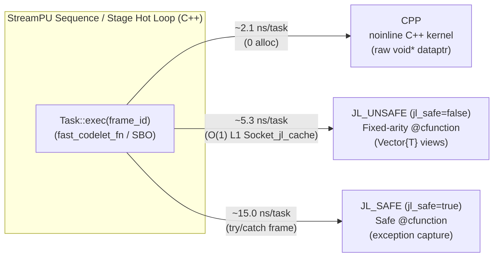
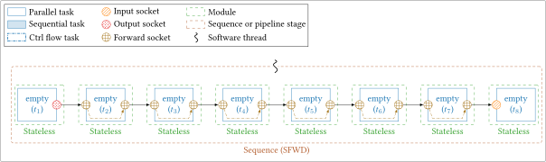
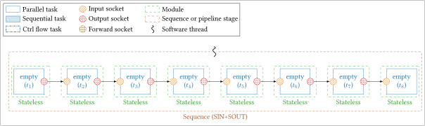
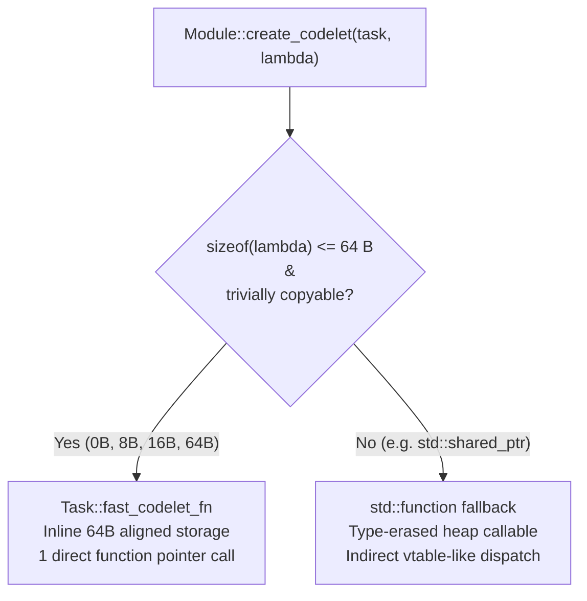
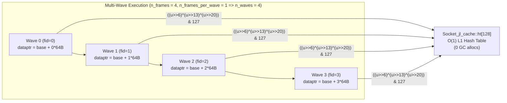
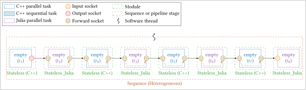
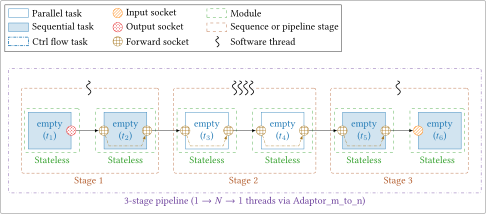
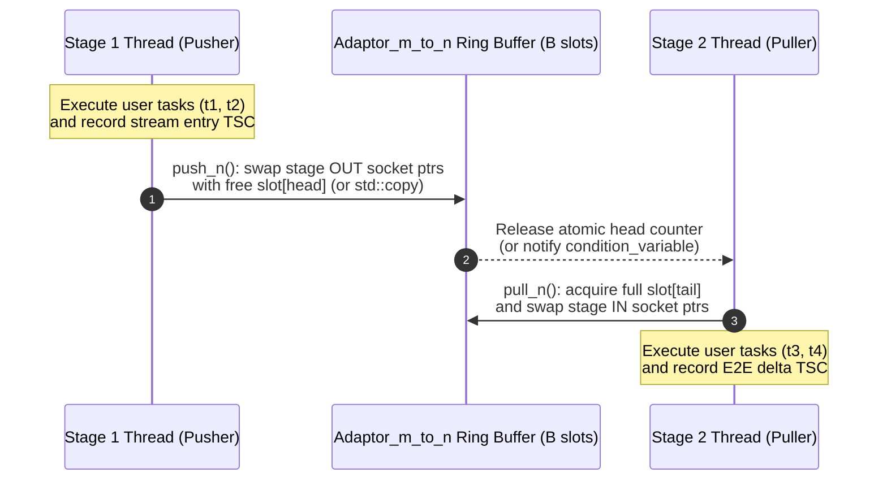
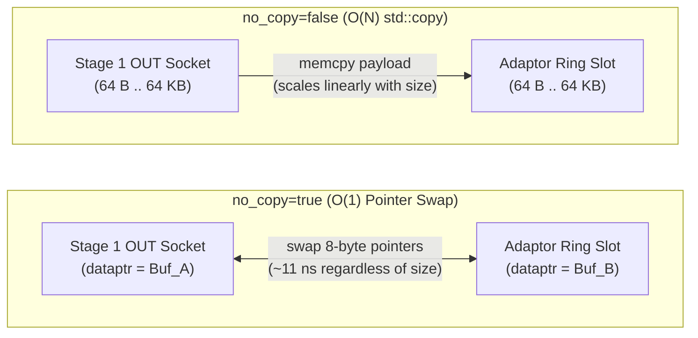

# Runtime Overhead Micro-Benchmarks

When designing high-throughput, low-latency streaming systems (such as Software-Defined Radio, real-time audio/video processing, or radar pipelines), the **framework scheduling and language-bridge overhead** per task determines the finest task granularity that can be scheduled without degrading throughput or real-time tail latency.

`StreamPU` provides two **empty-task runtime overhead micro-benchmarks** in `tests/benchmarks/`:

1. **`benchmark-sequence-overhead`** (`tests/benchmarks/sequence_overhead.cpp`): Quantifies single-thread and data-parallel [`Sequence`](sequence.md) task-dispatch overhead, socket-binding modes, lambda capture storage, multi-wave execution, control-flow (`Switcher`) branching, and C++/Julia language-bridge trampolines (`CPP`, `JL_UNSAFE`, `JL_SAFE`).
2. **`benchmark-pipeline-overhead`** (`tests/benchmarks/pipeline_overhead.cpp`): Quantifies multi-stage [`Pipeline`](pipeline.md) and [`Adaptor_m_to_n`](pipeline.md) inter-stage synchronization overhead across active spin-waiting vs. passive condition variables, FIFO ring-buffer depths, pipeline stage counts, $1 \to N \to 1$ data-parallel fork-join stages, and zero-copy pointer swapping (`swap_buffers`) vs. memory copying (`std::copy`).

!!! info "Indicative Benchmark Environment & Hardware Configuration"
    All numerical latency values and example tables reported on this page are provided **for indicative purposes only** and were measured on the following system:

    - **Processor**: Apple M1 Pro (`arm64-apple-darwin`, 10-core CPU: 8 performance cores + 2 efficiency cores)
    - **Operating System**: macOS 26.6.2 (Darwin 25.6.0)
    - **C++ Compiler**: Apple Clang 21.0.0 (`clang-2100.1.1.101`, compiled in `Release` mode with `-O3 -DNDEBUG`)
    - **Julia Runtime**: Julia 1.11.7 (`libjulia`, `-DSPU_LINK_JULIA=ON`)

    Actual latencies and tail percentiles (`P99`, `P99.99`, `MAX`) will vary depending on your CPU microarchitecture, clock frequency, cache hierarchy, OS scheduler, compiler version, and system load. You can run both benchmarks directly on your target machine to characterize your own platform.

---

## 1. Methodology, Backends & Dual Display Modes

### Isolating Pure Runtime Overhead

To measure **100% of the runtime dispatch, buffer management, and synchronization overhead** with **0% payload arithmetic distortion**, every task in these benchmarks executes an **empty codelet** that touches its socket pointer(s) without performing any computation on the buffer payload:

- **Native C++ (`CPP`)**: Calls an out-of-line function marked `__attribute__((noinline))` (or `__declspec(noinline)`) containing an inline compiler barrier (`asm volatile("" : : "r"(ptr), "r"(frame_id) : "memory")`). This forces the CPU to materialize every socket `dataptr` and execute a real `call`/`ret` instruction pair while preventing the compiler from inlining, constant-folding, or dead-code-eliminating the loop.
- **Julia Unsafe Trampoline (`JL_UNSAFE`, when compiled with `-DSPU_LINK_JULIA=ON`)**: Invokes a Julia function (`_spu_bench_empty_jl_N(...) = Int32(0)`) via a pre-compiled `@cfunction` native function pointer (`Stateless_Julia` / `Stateful_Julia` with `set_jl_safety(false)`).
- **Julia Safe Trampoline (`JL_SAFE`, when compiled with `-DSPU_LINK_JULIA=ON`)**: Invokes the same Julia function wrapped in a `try ... catch` `@cfunction` trampoline (`set_jl_safety(true)`) that translates Julia exceptions into C++ `spu::tools::runtime_error` exceptions.



| Backend | Language / API | Socket View Passed to Codelet | Typical Overhead (`SFWD`) |
| :--- | :--- | :--- | :---: |
| **`CPP`** | C++11 (`spu::module::Stateless`) | Raw pointer `tsk[s].get_dataptr()` (`void*`) | **~2.1 ns / task** |
| **`JL_UNSAFE`** | Julia (`Stateless_Julia`, `jl_safe=false`) | GC-rooted 1D `Vector{T}` (`Socket_jl_cache`) | **~5.3 ns / task** |
| **`JL_SAFE`** | Julia (`Stateless_Julia`, `jl_safe=true`) | GC-rooted 1D `Vector{T}` + `try/catch` barrier | **~15.0 ns / task** |

### Dual Display Modes & 2-Line Per-Case Granularity

Both `benchmark-sequence-overhead` and `benchmark-pipeline-overhead` print **two lines per benchmark case** (first the stream-level latency in `ns`, then the per-task latency in `ns`):

- In **`benchmark-sequence-overhead`**:
    1. **`ns/stm`**: Total execution latency per sequence **stream** (`ns/stream`, i.e., one complete execution of the sequence).
    2. **`ns/tsk`**: Execution latency normalized per individual **task** (`ns/task` = `ns/stream / n_tasks`).
- In **`benchmark-pipeline-overhead`**:
    1. **`E2E ns/stm`**: End-to-End wall-clock latency per **stream** across all pipeline stages (`ns/stream`, in nanoseconds).
    2. **`STG ns/tsk`**: Average execution latency per **task** inside a pipeline stage (`ns/task`, in nanoseconds, excluding inter-stage wait time).

In addition, both executables automatically switch between **two complementary table layouts** depending on the `-b` / `--backends` CLI flag:

1. **Mode 1 — Multi-Backend Average Comparison (default when multiple backends are active, e.g. `-b CPP,JL_UNSAFE,JL_SAFE`)**:
    - Table columns correspond to the active backends (`CPP | JL_UNSAFE | JL_SAFE`). Each column runs a homogeneous chain of tasks implemented in that backend.
2. **Mode 2 — Single-Backend Full Real-Time Percentiles (when a single backend is selected via `-b <BACKEND>`, e.g. `-b CPP` or `-b JL_UNSAFE`, or when compiled with `-DSPU_LINK_JULIA=OFF`)**:
    - Table columns display the full High-Dynamic-Range (HDR) hardware cycle counter distribution (in nanoseconds) for every single case:
        - `sequence_overhead`: `AVG(ns) | TICKS || STD(ns) | P50(ns) | P99(ns) | P99.9(ns) | P99.99(ns) | MAX(ns)`
        - `pipeline_overhead`: `AVG(ns) | OUT NS/STM || STD(ns) | P50(ns) | P99(ns) | P99.9(ns) | P99.99(ns) | MAX(ns)`

### Understanding Real-Time (RT) Metrics (`TICKS`, `OUT NS/STM`, `STD`, `P50`..`P99.99` & `MAX`)

When running in **Mode 2** (`-b <BACKEND>`), `spu::tools::Rt_stats` records the elapsed hardware timestamp counter delta (`t1 - t0`) of every single stream in an **8 KB L1-resident High-Dynamic-Range (HDR) logarithmic-linear histogram** (2048 buckets with exact 1-tick resolution in `[0..127]` ticks and $\le 0.78\%$ relative quantization error up to $2^{37}$ ticks, with zero heap allocation on the hot path):

| Column | Meaning |
| :--- | :--- |
| **`AVG(ns)`** | Arithmetic mean latency across all measured streams (`ns/stm`) or normalized per task (`ns/tsk`). |
| **`TICKS`** *(sequence)* | Mean number of raw hardware timer ticks elapsed per stream (`ns/stm` row) or per task (`ns/tsk` row), read via `spu::tools::read_tsc()` (`rdtsc` on x86_64, `cntvct_el0` on ARM64, `rdtime` on RISC-V). |
| **`OUT NS/STM`** *(pipeline)* | Average time interval (`ns/stream`) between two consecutive streams exiting the final pipeline stage. This is the inverse of the pipeline's steady-state throughput ($\text{Throughput} = 10^9 / \text{OUT NS/STM}$ streams/s). |
| **`STD(ns)`** | Standard deviation of the latency in nanoseconds, quantifying overall execution **jitter** around the mean. |
| **`P50(ns)`** | **50th percentile (Median)**: 50% of all streams completed at or below this latency. Reflects typical uninterrupted L1-hot execution. |
| **`P99(ns)`** | **99th percentile**: 99% of streams completed at or below this latency (only 1 stream in 100 was slower). |
| **`P99.9(ns)`** | **99.9th percentile**: 99.9% of streams completed at or below this latency (1 stream in $1\,000$). |
| **`P99.99(ns)`** | **99.99th percentile**: 99.99% of streams completed at or below this latency (1 stream in $10\,000$). Essential for real-time systems (SDR, radar, audio) where packet drops occur on tail outliers rather than on the average. |
| **`MAX(ns)`** | **Worst-case outlier**: Maximum latency recorded for any single stream during the entire run (typically caused by an OS scheduler preemption, page fault, inter-core migration, or GC pause). |

!!! note "Why can `TICKS` be `< 1.0` and `P50(ns)` be `0.00` on Apple Silicon (ARM64)?"
    On x86_64 processors, `rdtsc` increments at the CPU reference clock (~3 GHz, so **1 tick $\approx$ 0.33 ns**). On **Apple Silicon (M1/M2/M3/M4)**, however, the user-space ARM Generic Timer register `cntvct_el0` increments at a fixed **24 MHz** crystal frequency, meaning **1 hardware tick = $1 / (24 \times 10^6)\text{ s} \approx 41.67\text{ ns}$**.

    When an 8-task C++ sequence executes in **~18 ns** (less than one `41.67 ns` tick):

    - Each individual stream execution (`t1 - t0`) straddles a 24 MHz clock edge with probability $p \approx 18 / 41.67 \approx 43\%$: roughly **57% of streams measure `0` tick** (`0.00 ns`, which is why the median **`P50(ns)` is `0.00`**) and **43% measure `1` tick** (`41.67 ns`, which is why **`P99(ns)` is `41.67`** and **`P99.99(ns)` is `83.33 = 2 × 41.67`**).
    - Over $100\,000$ streams, this stochastic sampling converges to the exact sub-tick average: **`TICKS = 0.43` ticks/stream** (`0.43 × 41.67 ns ≈ 17.9 ns/stm`), and **`0.43 / 8 ≈ 0.05` ticks/task** on the `ns/tsk` row.

---

## 2. Sequence Overhead Benchmark (`sequence_overhead.cpp`)

`benchmark-sequence-overhead` executes **7 benchmark sections** isolating each aspect of `Sequence` and `Task` execution.

### Section 1: Baseline & Socket Types (`8` empty tasks per sequence)

This section compares a homogeneous 8-task linear chain across all socket-binding topologies against a bare C++ `noinline` function call loop:

=== "Forward Sockets (`SFWD` chain)"
    <figure markdown>
      { width="820" }
      <figcaption>Homogeneous 8-task `SFWD` chain (`1x SOUT -> 6x SFWD -> 1x SIN`): all 8 tasks share a single buffer in-place.</figcaption>
    </figure>

=== "Input/Output Sockets (`SIN+SOUT` chain)"
    <figure markdown>
      { width="820" }
      <figcaption>Homogeneous 8-task `SIN+SOUT` chain (`1x SOUT -> 6x (SIN+SOUT) -> 1x SIN`): compares `no_copy_mode=true` (pointer rebinding at init) vs `no_copy_mode=false` (`std::copy` per socket).</figcaption>
    </figure>

- **What is done**:
    - `Bare call`: Executes 8 back-to-back calls to `empty_kernel_0(t)` in a plain `for` loop without `StreamPU`.
    - `0-socket task-bound chain`: 8 tasks without data sockets bound via `t_next = t_prev` (only the implicit `status` socket exists).
    - `SFWD chain`: Task $t_1$ has `SOUT`, Tasks $t_2$–$t_7$ have `SFWD`, Task $t_8$ has `SIN`.
    - `SIN+SOUT chain (no_copy_mode=true)`: Tasks $t_2$–$t_7$ have separate `SIN` and `SOUT` sockets; `Sequence` rebinds `SIN::dataptr` directly to the upstream `SOUT::dataptr` at graph initialization.
    - `SIN+SOUT chain (no_copy_mode=false)`: Intermediate `SIN` sockets keep private buffers and perform a runtime `memcpy` (`std::copy`) before each task execution.
- **What it shows in StreamPU**:
    - Adding `StreamPU` `Sequence` scheduling over a bare C++ `noinline` call (~0.70 ns/task, ~5.60 ns/stream) adds **only ~1.4 ns per task** (~2.16 ns/task, ~17.3 ns/stream).
    - In `no_copy_mode=true`, **`0-socket`**, **`SFWD`**, and **`SIN+SOUT`** have **identical runtime latency** (~2.16–2.29 ns/task in `CPP`, ~5.31 ns/task in `JL_UNSAFE`) because socket pointer resolution happens once during `Sequence` initialization (`set_no_copy_mode(true)`), reducing runtime socket access to a direct L1 pointer load.

---

### Section 2: Number of Sockets per Task (`1, 2, 4, 8, 16` sockets)

- **What is done**: Builds an 8-task `SFWD` chain where each task declares $S \in \{1, 2, 4, 8, 16\}$ parallel sockets (`s0 .. s{S-1}`) and materializes all $S$ data pointers inside the codelet.
- **What it shows in StreamPU**:
    - In **`CPP`**, latency scales linearly by ~0.3–0.5 ns per additional socket pointer load from L1 cache (`2.14 ns/tsk` for 1 socket $\to$ `9.92 ns/tsk` for 16 sockets).
    - In **`JL_UNSAFE`**, `Module_Julia` uses an **unrolled inline fast-check array** (`fast_scks[8]`) and **fixed-arity `@cfunction` trampolines** (`_spu_tramp_1..16`, passing arguments directly in CPU registers). For $S \le 8$, `JL_UNSAFE` stays between `5.27 ns/tsk` and `11.18 ns/tsk`. At $S = 16$ (which requires $16 + 2 = 18 > 16$ total arguments including `frame_id` and `n_frames_per_wave`), `Module_Julia` automatically falls back to its packed `Ptr{Ptr{Cvoid}}` `@cfunction` trampoline (~84 ns/tsk).

---

### Section 3: C++ Lambda Capture Size & Julia Stateful Arguments



- **What is done**:
    - **C++ Lambda Captures**: Tests 5 capture footprints (`sizeof(lambda)`, i.e. the total size of the variables captured inside `[...]`) on an 8-task `SFWD` chain: `0-byte []`, `8-byte [ptr]`, `16-byte [2x size_t]`, `64-byte [8x size_t]`, and a non-trivial `std::shared_ptr<size_t>` capture.
    - **Julia Stateful Arguments (`#ifdef SPU_JULIA`)**: Tests `Stateful_Julia` modules with `0, 1, 2` mutable Julia states (`create_state`) and `0, 2` scalar constants (`create_constant`).
- **What it shows in StreamPU**:
    - `Task` stores trivially copyable lambdas up to **64 bytes** inside an inline `fast_codelet_storage` buffer invoked through a direct C function pointer (`fast_codelet_fn`). Consequently, **0 B, 8 B, 16 B, and 64 B captures all run at the exact same ~2.2 ns/task speed**, avoiding the indirect dispatch penalty of `std::function`.
    - In `Stateful_Julia`, state pointers (`jl_states_ptr`) and constants (`jl_constants_ptr`) are pre-written once into `Task_jl_cache::func_args` during `eval()` and never re-checked on the hot path. Adding 1 or 2 Julia states and constants adds **0.0 ns of runtime overhead** (~5.28 ns/task across all combinations).

---

### Section 4: Task & Sequence Execution Modes

- **What is done**: Compares the 4 execution modes of `Task` and `Sequence` on an 8-task `SFWD` chain:
    1. `fast=true, _exec_without_statuses`: Default high-speed path when the caller's `stop_condition` does not inspect per-task status arrays.
    2. `fast=true, _exec (with statuses)`: Caller passes `stop_condition(const std::vector<const int*>& statuses)`.
    3. `fast=false`: Enables runtime debug checks (buffer size verification, `dataptr != nullptr` checks, debug filling).
    4. `stats=true`: Enables per-task `std::chrono::steady_clock::now()` timing around every individual task execution.
- **What it shows in StreamPU**:
    - `_exec_without_statuses` saves ~0.8 ns/task over `_exec` by invoking `Task::exec()` directly inside a flat loop without storing into the `statuses` vector.
    - `set_fast(true)` saves ~3.8 ns/task compared to `set_fast(false)` (~2.16 ns vs ~5.95 ns).
    - Enabling per-task `set_stats(true)` adds two OS clock reads (`steady_clock::now()`) per task (~33 ns/task on macOS ARM64 / Linux `clock_gettime`). In contrast, `Sequence::set_rt_stats(true)` reads the hardware cycle counter (`rdtsc` / `CNTVCT_EL0`) only **once per stream** at the end of the sequence, adding < 0.2 ns/task!

---

### Section 5: Sequence Chain Length Scaling (`2, 4, 8, 16, 32, 64, 128` tasks)

- **What is done**: Measures the latency per stream (`ns/stm`) and per task (`ns/tsk`) as the number of tasks in a linear `SFWD` sequence grows from `2` to `128`.
- **What it shows in StreamPU**:
    - The outer `Sequence::exec` loop (`stop_condition` check + sub-sequence traversal) has a small fixed cost (~3–4 ns per stream).
    - As the chain grows from `2` tasks (`3.72 ns/tsk` in `CPP`) to `16–64` tasks, this per-stream cost is amortized across more tasks, converging to **1.70–1.87 ns/tsk** in `CPP` and **5.25–6.91 ns/tsk** in `JL_UNSAFE`.
    - At `128` tasks, cycling through 128 distinct `Task` and `Socket` objects per stream starts exceeding the L1 data/instruction working set, slightly increasing latency (`4.34 ns/tsk` in `CPP`, `9.14 ns/tsk` in `JL_UNSAFE`).

---

### Section 6: Multi-Wave Execution (`n_waves = 1, 2, 4, 8`)



- **What is done**: Sets `n_frames = n_waves` (`1, 2, 4, 8`) with `n_frames_per_wave = 1`, so each stream processes `n_waves` waves (executing each task `n_waves` times per stream while `Task::_exec` advances all socket `dataptr` pointers by `exec_step` bytes between waves and shifts them back on the final wave).
- **What it shows in StreamPU**:
    - Stepping socket pointers across waves in C++ costs only ~0.5–1.5 ns per wave (`2.73 ns` per task$\cdot$wave at `n_waves = 8`).
    - In Julia (`JL_UNSAFE`), because the socket `dataptr` changes on every wave ($w = 0 \dots W-1$), `Module_Julia` cannot use its single-pointer `last_dataptr` fast path. Instead, `Socket_jl_cache` resolves the corresponding pre-wrapped `Vector{T}` in $O(1)$ via its **128-entry direct-mapped L1 hash table** (`ht[128]` indexed by `((u >> 6) ^ (u >> 13) ^ (u >> 20)) & 127`), keeping multi-wave Julia execution at **~6.40 ns per task$\cdot$wave** with zero heap or GC allocations.

---

### Section 7: Multi-Thread, Heterogeneous C++/Julia & Control Flow (`Switcher`)

=== "Heterogeneous C++ / Julia Chain"
    <figure markdown>
      { width="820" }
      <figcaption>Heterogeneous 8-task `SFWD` sequence alternating `Stateless` (C++) and `Stateless_Julia` tasks on the same buffer.</figcaption>
    </figure>

=== "Control Flow (`Switcher` commute + select)"
    <figure markdown>
      { width="820" }
      <figcaption>Exclusive control-flow path using a `Switcher` module (`commute` + `select` sub-sequences).</figcaption>
    </figure>

- **What is done**:
    - **Multi-Thread Homogeneous (`t = 1, 2, 4`)**: Clones the homogeneous 8-task `SFWD` sequence across $t$ independent threads (`Sequence(first_task, n_threads)`).
    - **Heterogeneous C++/Julia Chain (`t = 1, 4`)**: Alternates `CPP` and `JL_UNSAFE` tasks within the **same** 8-task `SFWD` sequence (`CPP -> JL_UNSAFE -> CPP -> JL_UNSAFE -> ...`).
    - **Control Flow (`Switcher commute+select`)**: Routes a packet through `ctrl_gen -> src -> switcher[commute] -> branch0 -> switcher[select] -> snk` with `no_copy=true` and `no_copy=false`.
- **What it shows in StreamPU**:
    - Mixing C++ and Julia tasks inside the same `Sequence` incurs **zero cross-language transition penalty**: the heterogeneous chain runs at the exact arithmetic average of its constituent tasks (`3.50 ns/tsk`, halfway between `2.10 ns/tsk` for `CPP` and `5.35 ns/tsk` for `JL_UNSAFE`) because both backends share the same raw C++ socket memory pointers (`dataptr`).
    - `Switcher` dynamic path selection (`Sub_sequence` branching + `commute`/`select` status propagation) costs ~6.1 ns/tsk in `no_copy=true`.

---

### Running `benchmark-sequence-overhead`

=== "Mode 1: Multi-Backend Comparison (Default)"
    ```bash
    # Run all available C++/Julia backends (CPP, JL_UNSAFE, JL_SAFE):
    ./build/bin/benchmark-sequence-overhead -e 100000 -d 64
    ```

    ```text
    #######################################################################
    # StreamPU Empty-Task Runtime Overhead Benchmark (sequence_overhead)  #
    #######################################################################
    #   - base n_exec  = 100000 (scaled for JL_SAFE / long chains)
    #   - data_length  = 64 bytes
    #   - n_warmup     = 256
    #   - rt_skip      = 0
    #   - has_julia    = true
    #   - backends     = CPP, JL_UNSAFE, JL_SAFE
    #   - display mode = Multi-Backend Average Comparison (pass -b <BACKEND> for RT percentiles)
    #
    # =======================================================================================================
    #  1. BASELINE & SOCKET TYPES (8 empty tasks per sequence)
    # -------------------------------------------------------------------------------------------------------
    #  BENCHMARK CASE                          | TASKS | UNIT   ||          CPP |    JL_UNSAFE |      JL_SAFE
    #  ----------------------------------------+-------+--------++--------------+--------------+-------------
    #  Bare call (C++ noinline)                |     8 | ns/stm ||      5.60 ns |          N/A |          N/A
    #                                          |     8 | ns/tsk ||      0.70 ns |          N/A |          N/A
    #  0-socket task-bound chain (status only) |     8 | ns/stm ||     21.28 ns |     43.66 ns |    123.82 ns
    #                                          |     8 | ns/tsk ||      2.66 ns |      5.46 ns |     15.48 ns
    #  SFWD chain (1x OUT, 6x FWD, 1x IN)      |     8 | ns/stm ||     17.31 ns |     43.97 ns |    127.81 ns
    #                                          |     8 | ns/tsk ||      2.16 ns |      5.50 ns |     15.98 ns
    #  SIN+SOUT chain (no_copy_mode=true)      |     8 | ns/stm ||     18.35 ns |     42.50 ns |    132.87 ns
    #                                          |     8 | ns/tsk ||      2.29 ns |      5.31 ns |     16.61 ns
    #  SIN+SOUT chain (no_copy_mode=false)     |     8 | ns/stm ||     18.39 ns |     42.86 ns |    131.96 ns
    #                                          |     8 | ns/tsk ||      2.30 ns |      5.36 ns |     16.50 ns
    ```

=== "Mode 2: Single-Backend Full RT Percentiles (`-b <BACKEND>`)"
    ```bash
    # Focus on a single backend (-b CPP, -b JL_UNSAFE, or -b JL_SAFE) to display full HDR RT percentiles + MAX:
    ./build/bin/benchmark-sequence-overhead -e 100000 -b CPP
    ```

    ```text
    #######################################################################
    # StreamPU Empty-Task Runtime Overhead Benchmark (sequence_overhead)  #
    #######################################################################
    #   - base n_exec  = 100000 (scaled for JL_SAFE / long chains)
    #   - data_length  = 64 bytes
    #   - n_warmup     = 256
    #   - rt_skip      = 0
    #   - has_julia    = true
    #   - backends     = CPP
    #   - display mode = Single-Backend Full RT Percentiles (AVG, STD, P50..P99.99, MAX)
    #
    # ===========================================================================================================================================================
    #  1. BASELINE & SOCKET TYPES (8 empty tasks per sequence) [Backend: CPP]
    # -----------------------------------------------------------------------------------------------------------------------------------------------------------
    #  BENCHMARK CASE                          | TASKS | UNIT   ||   AVG(ns) |     TICKS ||   STD(ns) |   P50(ns) |   P99(ns) | P99.9(ns) |P99.99(ns) |   MAX(ns)
    #  ----------------------------------------+-------+--------++-----------+-----------++-----------+-----------+-----------+-----------+-----------+----------
    #  Bare call (C++ noinline)                |     8 | ns/stm ||      5.82 |      0.14 ||     13.13 |      0.00 |     41.67 |     41.67 |     41.67 |     83.34
    #                                          |     8 | ns/tsk ||      0.73 |      0.02 ||      1.64 |      0.00 |      5.21 |      5.21 |      5.21 |     10.42
    #  0-socket task-bound chain (status only) |     8 | ns/stm ||     18.05 |      0.43 ||     20.22 |      0.00 |     41.67 |     41.67 |     83.33 |    125.00
    #                                          |     8 | ns/tsk ||      2.26 |      0.05 ||      2.53 |      0.00 |      5.21 |      5.21 |     10.42 |     15.62
    #  SFWD chain (1x OUT, 6x FWD, 1x IN)      |     8 | ns/stm ||     17.50 |      0.42 ||     20.17 |      0.00 |     41.67 |     41.67 |     83.34 |     83.34
    #                                          |     8 | ns/tsk ||      2.19 |      0.05 ||      2.52 |      0.00 |      5.21 |      5.21 |     10.42 |     10.42
    ```

---

## 3. Pipeline Overhead Benchmark (`pipeline_overhead.cpp`)

While `Sequence` executes all tasks sequentially on the same thread, [`Pipeline`](pipeline.md) partitions a task graph into $K$ concurrent stages (`Sequence` instances) connected by lock-free/blocking [`Adaptor_m_to_n`](pipeline.md) ring buffers (`push_n` / `pull_n`).

<figure markdown>
  { width="780" }
  <figcaption>Multi-stage empty-task `Pipeline` benchmark topology: Stage 1 (1 thread) -> Stage 2 (N threads) -> Stage 3 (1 thread) synchronized via `Adaptor_m_to_n`.</figcaption>
</figure>

Each benchmark case in `benchmark-pipeline-overhead` reports **two rows** (in nanoseconds, ordered consistently with `benchmark-sequence-overhead`):

1. **`E2E ns/stm` (End-to-End Stream Latency, in `ns`)**: Total wall-clock time elapsed from the moment a stream enters Stage 1 to the moment it exits the final stage (`ns/stream`), including inter-stage FIFO queuing and thread wake-up latency.
2. **`STG ns/tsk` (Stage Latency per Task, in `ns`)**: Execution time per task inside a pipeline stage (measured via per-stage hardware cycle counters, excluding inter-stage wait time). It captures the cost of executing the stage's user tasks **plus** the amortized cost of `Adaptor_m_to_n::push_n` and `pull_n` buffer swapping.



---

### Section 1: Waiting Strategy (`active_wait=true` vs `active_wait=false`)

- **What is done**: Runs a 2-stage pipeline (2 empty tasks per stage) with `buffer_size = 1` and `buffer_size = 16`, comparing **active spin-waiting** (`active_wait=true`) against **passive OS condition variables** (`active_wait=false`).
- **What it shows in StreamPU**:
    - With **`active_wait=true`**, worker threads poll the lock-free atomic SPSC ring-buffer counters in user space: end-to-end stream latency (`E2E ns/stm`) is **~210–230 ns** across threads, and stage task latency (`STG ns/tsk`) is **~5.1 ns/tsk** (`CPP`) and **~8.3 ns/tsk** (`JL_UNSAFE`)!
    - With **`active_wait=false`**, threads block on a `std::mutex` + `std::condition_variable` when the ring buffer is full or empty, incurring kernel `futex` / `ulock` context-switch overhead (**~4560–4940 ns** `E2E ns/stm` and ~180–210 ns/tsk `STG ns/tsk`). Increasing `buffer_size` from `1` to `16` in passive mode reduces the frequency of sleep/wake transitions (`4559 ns/stm` $\to$ `2235 ns/stm` E2E, and `193 ns/tsk` $\to$ `21.5 ns/tsk` STG).

---

### Section 2: Inter-Stage FIFO Buffer Size (`buffer_size = 1, 2, 4, 8, 16, 64`)

- **What is done**: Sweeps the number of slots $B \in \{1, 2, 4, 8, 16, 64\}$ in the `Adaptor_m_to_n` ring buffer between 2 stages (`active_wait=true, no_copy=true`).
- **What it shows in StreamPU**:
    - Highlights **Little's Law** ($L = \lambda W$) in streaming pipelines:
        - Small buffers (`buffer_size = 1` or `2`) enforce tight producer-consumer coupling, yielding the **lowest End-to-End stream latency** (`E2E = 146–217 ns/stm`).
        - Larger buffers (`buffer_size = 16` or `64`) decouple stages to absorb execution jitter, but because Stage 1 produces streams slightly faster than Stage 2 consumes them, the FIFO stays full in steady state and streams wait through $B$ queued slots (`E2E = 663–2658 ns/stm` in `CPP`).
    - In Julia (`JL_UNSAFE`), zero-copy buffer swapping rotates $B+2$ distinct C++ buffer pointers through each socket. Because `Socket_jl_cache::ht[128]` hashes cache-line-aligned pointers (`u >> 6`) with zero collisions up to $B = 64$, `JL_UNSAFE` maintains **~8.1–19.0 ns/tsk** across all buffer sizes with zero GC activity.

---

### Section 3: Number of Pipeline Stages in Series (`2, 3, 4, 8` stages)

- **What is done**: Chains $K \in \{2, 3, 4, 8\}$ pipeline stages in series (each running on its own thread, with `buffer_size = 1` and `16`).
- **What it shows in StreamPU**:
    - From `2` to `4` stages (within physical performance cores), per-stage task overhead stays nearly constant (`~4.6–6.2 ns/tsk` in `CPP`, `~8.3–22.2 ns/tsk` in `JL_UNSAFE`), while end-to-end stream latency scales proportionally to the number of stage crossings (`~200 ns/stm` for 2 stages $\to$ `~480–925 ns/stm` for 4 stages at `buffer_size = 1`).

---

### Section 4: Data-Parallel Multi-Threading (`3 stages: 1 -> N -> 1 threads`)

- **What is done**: Configures a 3-stage pipeline where Stage 1 (1 thread) feeds Stage 2 replicated across $N \in \{1, 2, 4\}$ data-parallel threads via `Adaptor_1_to_n`, which then merges back into Stage 3 (1 thread) via `Adaptor_n_to_1` in strict stream order.
- **What it shows in StreamPU**:
    - Demonstrates `Adaptor_1_to_n` / `Adaptor_n_to_1` round-robin token passing across $N$ worker threads.
    - For Julia (`JL_UNSAFE`), validates `Thread_pool_Julia`, where each spawned C++ `std::thread` is adopted into the Julia runtime via `jl_adopt_thread()` and equipped with its own thread-local `Ref_keeper` GC frame and cloned `Task_jl_cache`.

---

### Section 5: Zero-Copy (`swap_buffers`) vs Copy (`std::copy`) Across Payload Sizes (`64 B` to `64 KB`)



- **What is done**: Compares `no_copy=true` (`set_no_copy_mode(true)`) and `no_copy=false` across 4 socket payload sizes: `64 B`, `1 KB`, `16 KB`, and `64 KB`.
- **What it shows in StreamPU**:
    - With **`no_copy=true`**, `Adaptor_m_to_n` exchanges full and empty buffers by **swapping 8-byte pointers** (`put_empty_buffer` / `get_filled_buffer`) and rebinding downstream `SFWD`/`SIN` sockets via flat pointer arrays. As a result, stage overhead remains **independent of payload size**: **`~185–830 ns/stm` E2E** and **`~11.0–24.9 ns/tsk` STG** even at **64 KB**!
    - With **`no_copy=false`**, `std::copy` copies the payload twice per stage boundary (`push_n` and `pull_n`), causing overhead to grow to **`~3270–4977 ns/stm` E2E** and **`~481–598 ns/tsk` STG** at 64 KB.

---

### Section 6: Number of Sockets Crossing `Adaptor_m_to_n` Boundary (`1, 2, 4, 8` sockets)

- **What is done**: Varies the number of parallel sockets $S \in \{1, 2, 4, 8\}$ crossing the `Adaptor_m_to_n` boundary between Stage 1 and Stage 2.
- **What it shows in StreamPU**:
    - Because `Adaptor_m_to_n` stores its internal ring buffer in a **1D slot-major contiguous array** (`buffer[(rd * buffer_size + slot) * n_sockets + s]`), all $S$ sockets of a stream reside in adjacent 8-byte words in the same L1 cache line and are published/consumed in a **single atomic index update**.

---

### Running `benchmark-pipeline-overhead`

=== "Mode 1: Multi-Backend Comparison (Default)"
    ```bash
    # Run all available backends (CPP, JL_UNSAFE, JL_SAFE when compiled with -DSPU_LINK_JULIA=ON):
    ./build/bin/benchmark-pipeline-overhead -e 20000 -d 64
    ```

    ```text
    #######################################################################
    # StreamPU Empty-Task Pipeline Overhead Benchmark (pipeline_overhead) #
    #######################################################################
    #   - base n_exec   = 20000 (scaled for passive wait / JL_SAFE)
    #   - data_length   = 64 bytes
    #   - n_warmup      = 256
    #   - rt_skip       = 0
    #   - has_julia     = true
    #   - backends      = CPP, JL_UNSAFE, JL_SAFE
    #   - display_mode  = Multi-Backend Average Comparison (use -b <BACKEND> for full RT percentiles)
    #
    # ==========================================================================================================
    #  1. WAITING STRATEGY: ACTIVE SPIN-WAIT vs PASSIVE CONDVAR (2 stages)
    # ----------------------------------------------------------------------------------------------------------
    #  PIPELINE BENCHMARK CASE                 | STGS | METRIC     ||          CPP |    JL_UNSAFE |      JL_SAFE
    #  ----------------------------------------+------+------------++--------------+--------------+-------------
    #  active_wait=true, buffer_size=1         |    2 | E2E ns/stm ||    230.14 ns |    209.71 ns |    223.88 ns
    #                                          |    2 | STG ns/tsk ||      5.13 ns |      8.22 ns |     19.67 ns
    #  active_wait=false, buffer_size=1        |    2 | E2E ns/stm ||   4559.38 ns |   4704.55 ns |   4825.21 ns
    #                                          |    2 | STG ns/tsk ||    178.40 ns |    184.76 ns |    194.91 ns
    #  active_wait=true, buffer_size=16        |    2 | E2E ns/stm ||    666.18 ns |   1079.10 ns |   1607.09 ns
    #                                          |    2 | STG ns/tsk ||      9.56 ns |     15.26 ns |     24.01 ns
    #  active_wait=false, buffer_size=16       |    2 | E2E ns/stm ||   2235.74 ns |   2565.76 ns |   2697.50 ns
    #                                          |    2 | STG ns/tsk ||     19.91 ns |     25.16 ns |     31.05 ns
    ```

=== "Mode 2: Single-Backend Full RT Percentiles (`-b <BACKEND>`)"
    ```bash
    # Focus on a single backend (-b CPP, -b JL_UNSAFE, or -b JL_SAFE) to display full HDR RT percentiles + MAX:
    ./build/bin/benchmark-pipeline-overhead -e 20000 -b CPP
    ```

    ```text
    #######################################################################
    # StreamPU Empty-Task Pipeline Overhead Benchmark (pipeline_overhead) #
    #######################################################################
    #   - base n_exec   = 20000 (scaled for passive wait / JL_SAFE)
    #   - data_length   = 64 bytes
    #   - n_warmup      = 256
    #   - rt_skip       = 0
    #   - has_julia     = true
    #   - backends      = CPP
    #   - display_mode  = Single-Backend Full RT Percentiles (E2E ns/stm + STG ns/tsk)
    #
    # ======================================================================================================================================================================
    #  1. WAITING STRATEGY: ACTIVE SPIN-WAIT vs PASSIVE CONDVAR (2 stages) [Backend: CPP]
    # ----------------------------------------------------------------------------------------------------------------------------------------------------------------------
    #  PIPELINE BENCHMARK CASE                 | STGS | METRIC     ||    AVG(ns) | OUT NS/STM ||    STD(ns) |    P50(ns) |    P99(ns) |  P99.9(ns) | P99.99(ns) |    MAX(ns)
    #  ----------------------------------------+------+------------++------------+------------++------------+------------+------------+------------+------------+-----------
    #  active_wait=true, buffer_size=1         |    2 | E2E ns/stm ||     235.12 |     154.38 ||      68.42 |     208.34 |     333.35 |     541.69 |    6250.25 |    8542.01
    #                                          |    2 | STG ns/tsk ||       5.48 |     154.38 ||       6.95 |       6.95 |      20.83 |      27.78 |      55.56 |     388.90
    #  active_wait=false, buffer_size=1        |    2 | E2E ns/stm ||    4755.35 |    3138.07 ||    2510.18 |    3958.31 |   12249.94 |   31874.84 |   74416.30 |   76832.95
    #                                          |    2 | STG ns/tsk ||     186.17 |    3138.07 ||     257.42 |     145.83 |     826.38 |    2395.82 |   11354.11 |   16152.70
    #  active_wait=true, buffer_size=16        |    2 | E2E ns/stm ||     674.86 |      43.09 ||     101.95 |     666.69 |     833.36 |     916.70 |    1041.70 |    5333.52
    #                                          |    2 | STG ns/tsk ||       9.58 |      43.09 ||      16.21 |      13.89 |      34.72 |      41.67 |      48.61 |    2513.98
    ```
